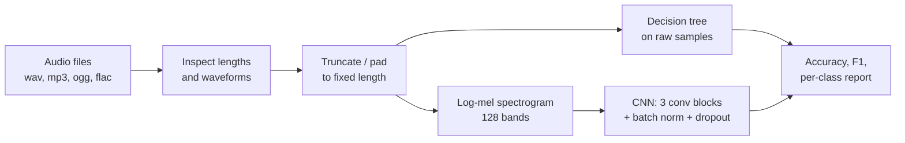

# Environmental Audio Classification

**Classifying explosions, emergency sirens, running engines and aircraft take-offs from raw audio: a decision-tree baseline on waveforms versus a CNN on mel-spectrograms.**

[](https://colab.research.google.com/github/dojedaro/audio-event-classification/blob/main/Audio%20Classification%20with%20ML%20Classifier%20and%20CNN.ipynb)
[](https://github.com/dojedaro/audio-event-classification/actions/workflows/notebooks.yml)

## Results

| Model | Input | Test clips | Accuracy | Macro F1 | Weighted F1 |
|---|---|---|---|---|---|
| Decision tree | raw waveform, truncated to a fixed length | 309 | 0.864 | 0.833 | 0.860 |
| 2D CNN | 128-band log-mel spectrogram, 5 s at 22.05 kHz | 247 | 1.000 | 1.000 | 1.000 |

Per-class F1 for the baseline shows where raw samples struggle: Explosion 0.84, Emergency Signals 0.84,
**Engine Running 0.67**, Take Off 0.98. A running engine is a steady drone that a tree can't separate from
other low-frequency noise without frequency features.

**Read the CNN's 100% with care.** Validation accuracy swung between 23% and 100% from epoch to epoch,
and one late epoch dropped back to 67% with a validation loss above 100. Training that unstable
rarely produces a perfect test score unless the test clips are very easy or closely related to
training clips (for example, several clips cut from the same recording). I haven't ruled that out,
and the two models were also evaluated on different splits (309 vs. 247 clips). The fair conclusion is
that spectrograms help a lot, not that the CNN is perfect.

## How it works



- **Baseline:** a decision tree on flattened, length-normalized waveforms, with no hand-made features. It sets the bar a learned representation has to beat.
- **CNN:** each clip becomes a 128-band log-mel spectrogram, treated as an image. Three convolutional blocks with batch normalization and max pooling, then dense layers with dropout (about 5.8M parameters), trained with Adam and early stopping.

## Run it

The notebook runs on Google Colab and reads audio from Google Drive, one folder per class
(`Explosion/`, `Emergency Signals/`, `Engine running/`, `Take off/`). The dataset isn't in this repo.

```bash
pip install -r requirements.txt
jupyter notebook "Audio Classification with ML Classifier and CNN.ipynb"
```

Outside Colab, replace the `google.colab.drive.mount` cell with a local path to the class folders.

## Stack

Python, librosa, NumPy, scikit-learn, TensorFlow/Keras, Matplotlib.

## Limitations and next steps

- **Split by recording, not by clip**, and evaluate both models on the same test set. That's the
  check that would confirm or deflate the 100%.
- Report a confusion matrix over several random seeds instead of one run.
- Add a stronger classical baseline (MFCC features + gradient boosting) so the CNN's gain is measured
  against features, not raw samples.

## License

MIT
